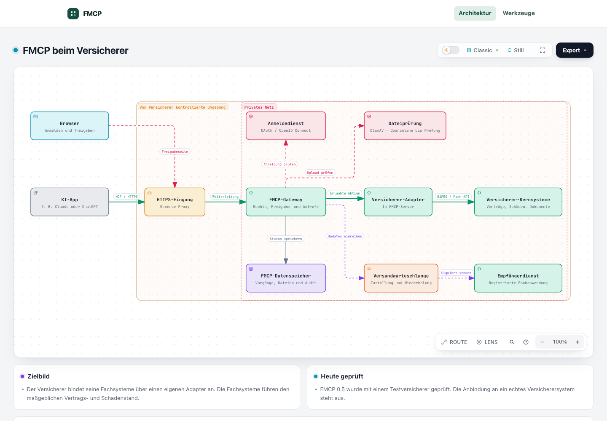
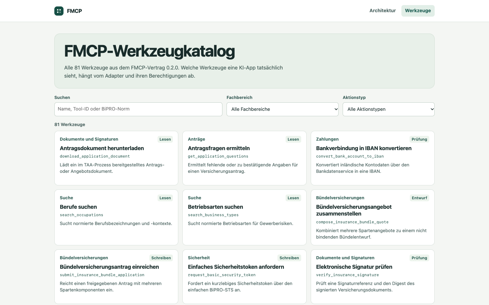

# FMCP

FMCP defines how AI apps read insurance data and submit changes for approval. This site documents the insurer architecture and all 81 tools in the FMCP 0.2.0 contract.

[Open the architecture and tool catalog](https://joelmd-frida.github.io/fmcp-insurance-protocol/)

## Insurer architecture

## Tool catalog

The German catalog can be searched by tool name, ID, or BiPRO norm and filtered by domain and action type. Each tool includes permissions, approval rules, JSON schemas, and synthetic request and response examples. The connected adapter and user permissions determine which tools an AI app sees.

## Open locally

Open `index.html` in a browser. The diagram and catalog work offline with no build step.

The architecture viewer includes [Archify under the MIT license](notices/archify-license.txt).
